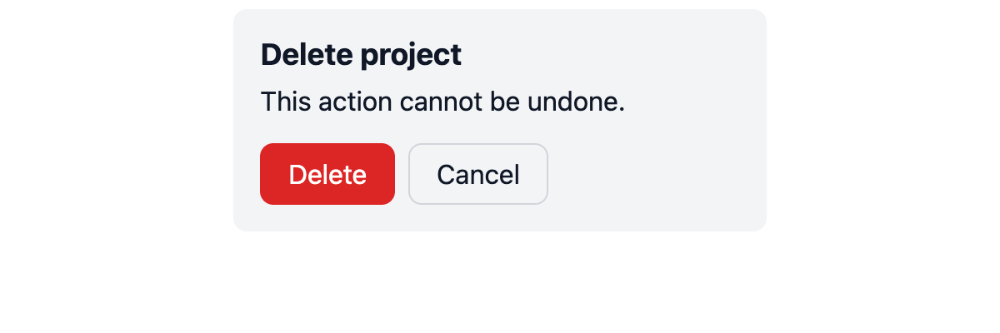

# mini-ui-kit

Small UI library with design tokens, reusable React components, and Storybook.

| Light | Dark |
|---|---|
|  |  |

| Button | Input (error state) |
|---|---|
|  |  |

## Components

| Component | Props |
|---|---|
| `Button` | `variant` (`primary` \| `secondary` \| `danger`), `size` (`sm` \| `md` \| `lg`), `loading`, plus native button props |
| `Input` | `label` (required), `error`, plus native input props |
| `Card` | `title` (required), `headingLevel` (`1`–`6`, default `3`), `children` |

```tsx
import { Button, Card, Input } from './src';

<Card title="Sign in">
  <Input label="Email" type="email" />
  <Button loading>Sign in</Button>
</Card>
```

`headingLevel` only changes the heading tag (document outline for screen readers).
The title keeps the same font size at every level.

## Design tokens

Tokens live in [`src/tokens/tokens.css`](src/tokens/tokens.css) as CSS variables
(`--color-*`, `--space-*`, `--radius-md`, `--font-*`). Import it once in your app.
Set `data-theme="dark"` on `<html>` to switch to the dark theme; only the semantic tokens change.

## Getting started

Requires Node and [pnpm](https://pnpm.io).

```bash
pnpm install
pnpm dev               # demo app
pnpm storybook         # Storybook on http://localhost:6006
pnpm build-storybook   # static build in storybook-static/
npx vitest run         # story play tests
```

Storybook has a **Light / Dark** switch in the toolbar and an Accessibility panel on every story.

## Deploy Storybook

Storybook is published to [Chromatic](https://www.chromatic.com):
https://6aeed261bb84ffa434aad5c6-cdwtuurtgx.chromatic.com/

1. Put the project token in `.env.local` (already ignored by git via `*.local`). Never commit it:
   ```
   CHROMATIC_PROJECT_TOKEN=<your project token>
   ```
2. Load the token, then build and publish with one command:
   ```bash
   set -a; source .env.local; set +a
   pnpm chromatic
   ```

`pnpm chromatic` builds Storybook and publishes `storybook-static` (the `chromatic` package is pinned in `devDependencies`).
Use it instead of `npx chromatic`, which fails with `chroma: command not found`.
Chromatic compares every story against the previous build and reports visual changes.

## Project status

Known follow-ups are tracked in [`REVIEW_TODO.md`](REVIEW_TODO.md).
